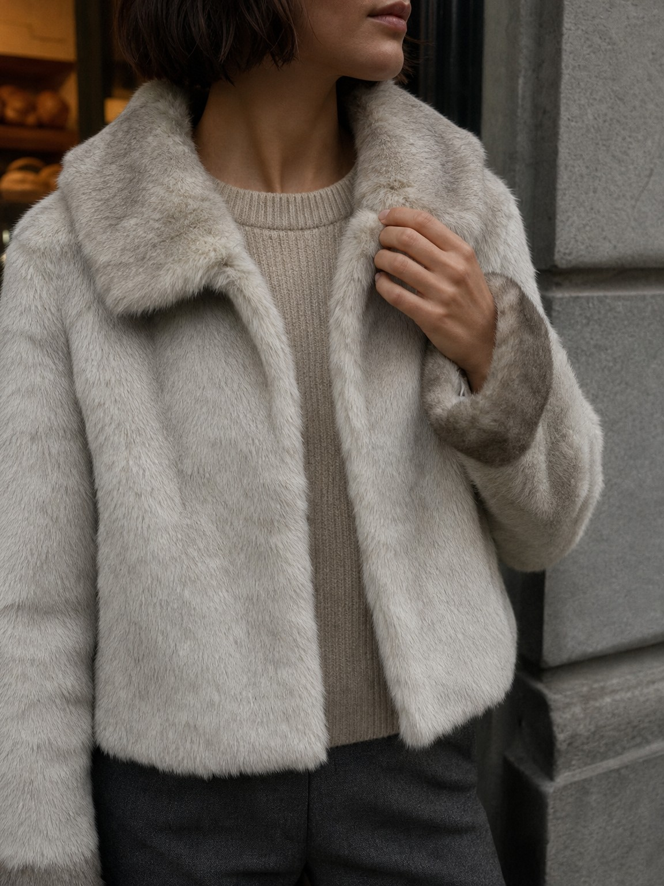

# BAUHAUS AI

**让每一件衣服，都有自己的表达。**

一张服装照片 → 一支约 24 秒的自然主义生活方式短片。

BAUHAUS AI 是一个在本机运行的 AI 服装短片导演，全程自动完成：读懂衣服、写创意与文案、拆五个镜头、画每一镜的第一帧并逐张质检、生成视频，最后剪辑、配字幕和配乐。气质接近无印良品的广告：**画面讲故事，文字讲商品。**

> *An AI fashion-film director that runs locally. Drop in one garment photo and it plans, storyboards, draws and checks first frames (GPT), generates five 5-second clips (Seedance 2.0 Mini via Xiaoyunque), then edits, captions and scores a ~24 s 3:4 film in the browser. Pure Python standard library plus a single HTML page.*



---

## 特点

- **一张图出片**：不需要商品资料，所有内容都从照片推断，并且只写看得见的事实。
- **衣服要像**：GPT 先写下一段“外观锁定描述”（毛长、斑驳、领型、袖口拼色……）。每一张首帧都以商品原图为最高优先级参考，再逐项比对，差异大就打回重画，最多四轮。
- **人在回路**：在策划、分镜、首帧、生成之后各停一次。确认按钮固定在右下角，按回车也可以确认。
- **浏览器里剪辑**：字幕排版、调色、混音和录制都在画布上实时完成，不需要 ffmpeg。
- **演示模式**：不调用任何接口，完整回放一支标杆样片的真实产出，适合展示。
- **开箱即用**：一个 `index.html` 加一个 `server.py`（只用 Python 标准库），双击就能启动。

## 快速开始

```bash
git clone https://github.com/ctruonghau-dot/bauhaus.git
cd bauhaus
python3 server.py
```

浏览器会自动打开 `http://127.0.0.1:7788`。macOS 上也可以直接双击 `启动 BAUHAUS AI.command`。

1. 先在**演示模式**里看一遍完整流程，不需要密钥。
2. 切到**工作模式**，点右上角 **「API 设置」**，填写 OpenAI API Key 和小云雀 Access Key，再点「测试连接」。
3. 把一张服装照片拖进页面中间的圆圈，点「确认」。

成片会自动保存到 `作品/`。

## 需要什么

| 项目 | 说明 |
| --- | --- |
| Python | 3.8 或更新，不需要任何第三方依赖 |
| 浏览器 | Chrome、Edge 或 Safari 的新版本 |
| OpenAI API Key | 用于看图、策划、写文案、画首帧、质检、剪辑决策。默认模型 `gpt-6.2-sol`，生图用 `gpt-image-2` |
| 小云雀 Access Key | 用于生成视频（Seedance 2.0 Mini，首帧模式），每支片约 100 积分 |

密钥只保存在本机的 `keys.json`（已被 `.gitignore` 排除），由本地服务转发请求，不会出现在网页里。

## 工作流

```
01 输入 → 02 理解 → 03 策划 ⏸ → 04 分镜 ⏸ → 05 首帧 ⏸ → 06 生成 ⏸ → 07 成片
  取色      GPT看图    GPT        五个镜头     GPT画+GPT查   小云雀       GPT剪辑 + 画布合成
```

⏸ 表示停下来等用户确认。

| 项目 | 规格 |
| --- | --- |
| 镜头 | 5 镜 × 5 秒，剪辑时每镜保留 3.6–4.6 秒 |
| 片尾卡 | 约 3.4 秒 |
| 总长 | 约 24 秒 |
| 画幅与分辨率 | 3:4 竖幅，960 × 1280 |
| 字幕 | 五屏商品说明，每镜一屏：第一屏是品名，最后一屏是穿着感受，中间三屏从面料、工艺细节、触感、版型中挑最贴合画面的 |

## 文档

- [使用说明](docs/使用说明.md)：安装、API 设置、各步骤、费用、常见问题
- [工作流设计](docs/工作流设计.md)：整体设计、每一步的提示词结构、容错与安全

## 目录

```
index.html                界面、流程编排、画布合成
server.py                 本地服务：密钥保管、请求转发、视频中转、保存成片
启动 BAUHAUS AI.command   macOS 双击启动
demo/                     演示模式素材：标杆样片《冬日买面包》的原图、五张首帧、五段视频、配乐和全部文本产出
home/                     首页背景影片：8 个镜头循环播放，frames/ 是对应的首帧图
docs/                     文档
```

## 许可

- 代码：[MIT License](LICENSE)
- `demo/` 与 `home/` 中的图片和视频由本项目用 GPT Image 与 Seedance 生成，随项目以 MIT 许可提供。`demo/src.jpg` 是示例商品照片。
- `demo/music.mp3`：*Parler à l'Invisible (Ambient Piano Requiem)*，作者 Adele Vivari，来自 [Jamendo](https://www.jamendo.com/track/2325550)，采用 [CC BY-SA 3.0](https://creativecommons.org/licenses/by-sa/3.0/) 授权，不适用 MIT。
- 使用者需自行遵守 OpenAI 与小云雀的服务条款，并对生成内容负责。
